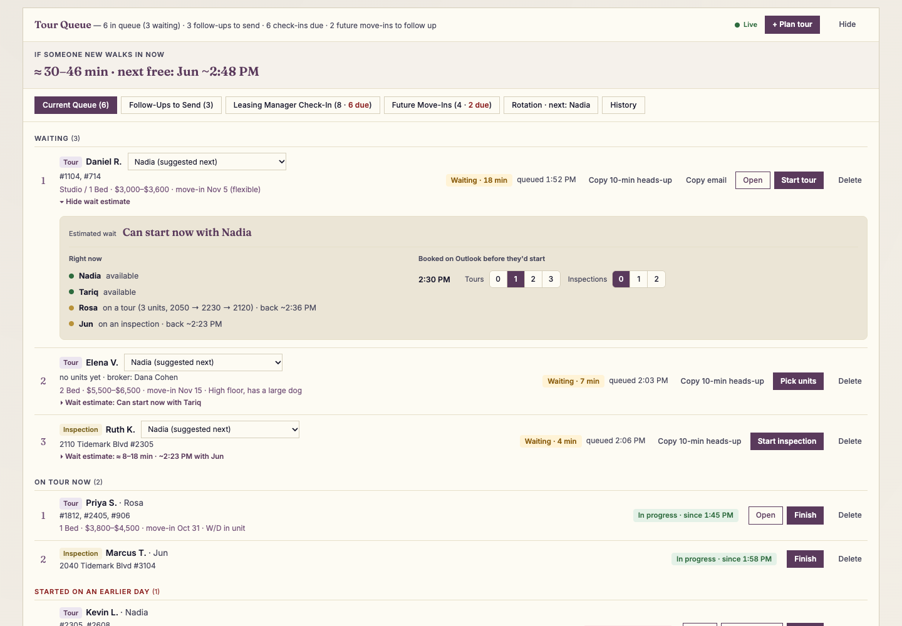
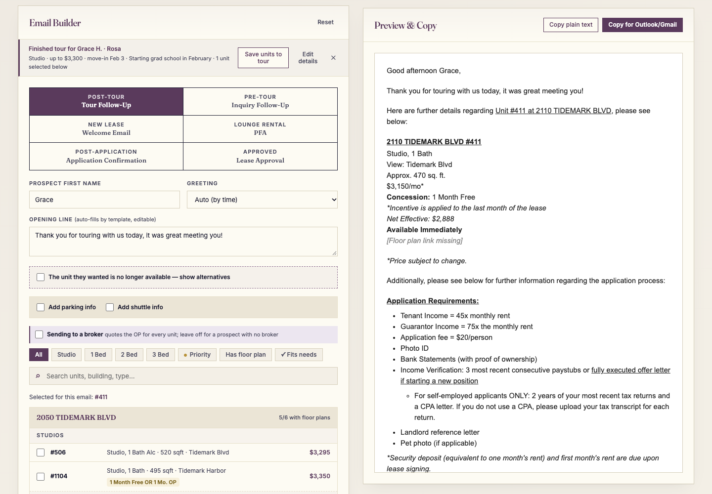
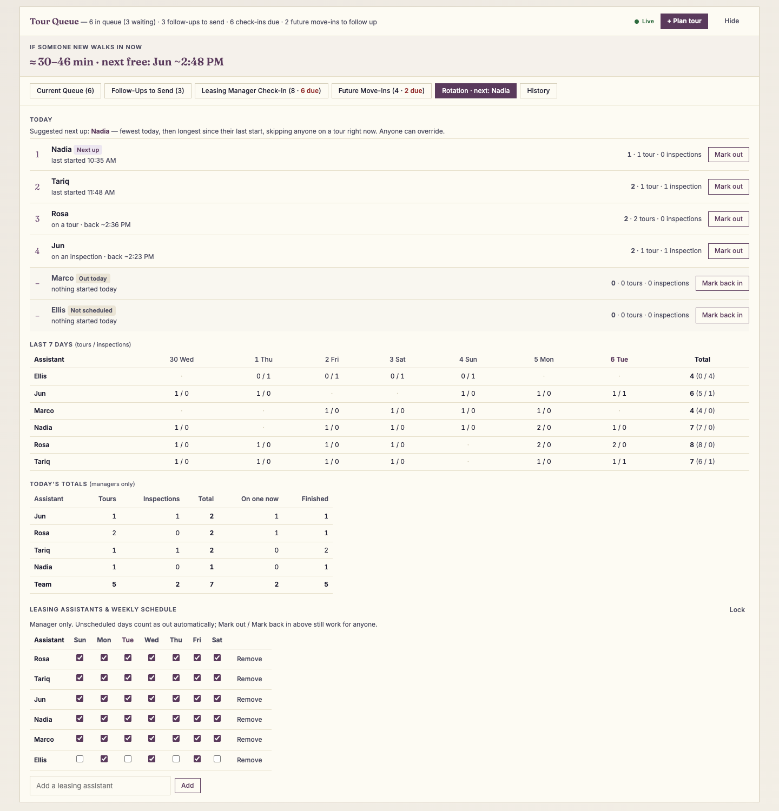
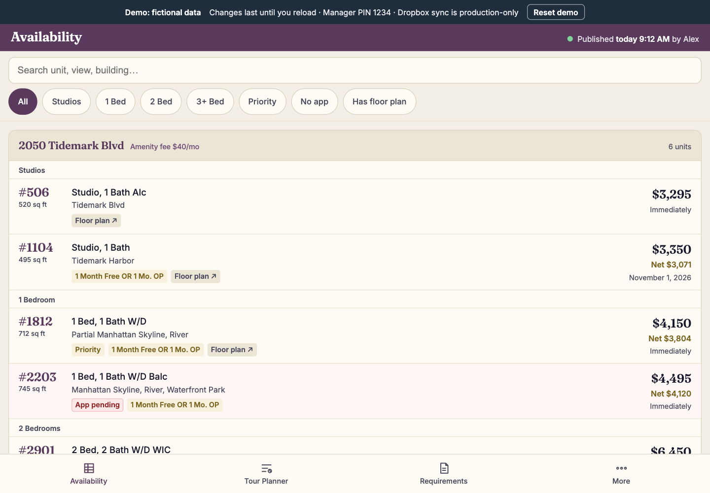
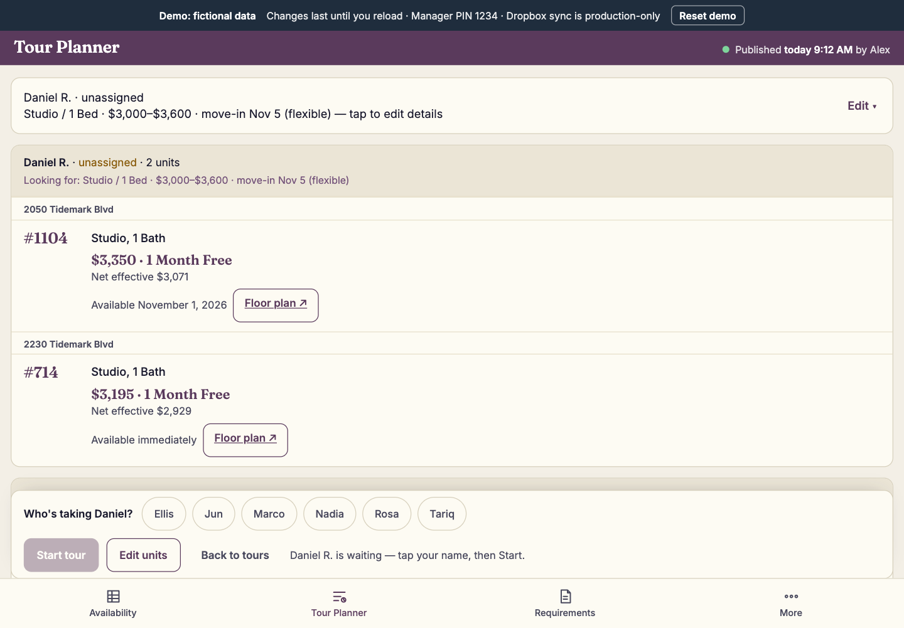
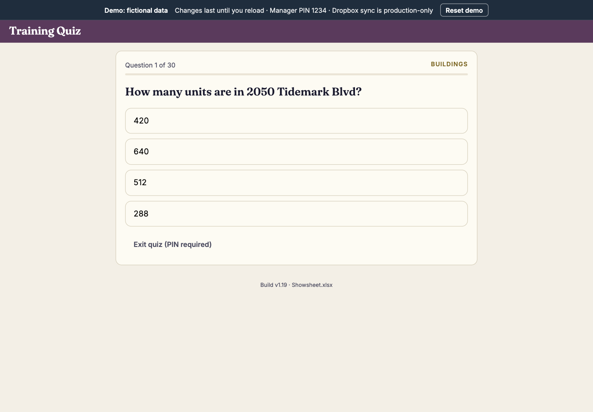
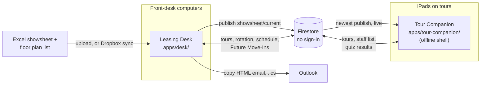

# Leasing Desk + Tour Companion

[](https://github.com/jaredmb05/portfolio-demos/actions/workflows/test.yml)

Two browser apps that run the front desk of a five-building rental leasing office. The **Leasing Desk** keeps the walk-in tour queue, picks who takes the next tour, estimates the wait and writes the follow-up emails; **Tour Companion** is the iPad app leasing assistants carry on tours, with live availability, pricing and a tour planner that quotes each unit.

This is a cleaned-up copy of a system in production use. **In production**, both apps share one Firestore database and update each other live. **The demo** in this repo runs each app on its own in-browser fake database seeded with invented buildings, people, prices and incentives; it needs only a static file server, with no npm install, no Firebase project and no network.



## Before and after

Before, the showsheet was a shared Excel file on Dropbox, and every assistant downloaded it to their iPad by hand each time prices or incentives changed. The iPads held hundreds of old copies, and people quoted from the wrong one. Emails were written by copying an old one and editing it, so expired concessions went out and had to be honored. Follow-ups were tracked on sticky notes, so about a quarter were never sent, and nobody could say with confidence which prospects had been contacted. Walk-ins couldn't be told how long they'd wait.

Now every Desk and iPad reads one published showsheet. Emails of every kind, follow-ups, inquiry replies, welcome, application and lease approval, are assembled from it with the broker rules and net rent built in, and they read better for it. Every tour is recorded with who, when, what was shown, what was offered, and how long it took. Follow-ups sit in a list until they're marked sent, and there's now a second follow-up from a leasing manager or lead agent, which didn't exist before. Walk-ins get a wait estimate. Tour length is a quality signal: three apartments across three buildings in under 45 minutes usually means the amenities were skipped. I'm copied on every email the office sends. Before the tools, at least one in five had a wrong price, incentive or unit. Since launch, none.

## What each app does, and who uses it

This section describes the apps as they run in production. How the demo differs is under [Run the demo](#run-the-demo) and [Known limitations](#known-limitations).

### Leasing Desk: leasing managers, on the front-desk computers (`apps/desk/`)
- **Tour Queue.** Prospects waiting, on a tour now, and tours started on an earlier day and never finished (flagged in red). Each row's filled button is its next step: Pick units, Start tour, Finish, Mark sent.
- **Wait estimate.** "If someone new walks in now" gives a range and the time the next assistant is free. Under each waiting prospect, a panel lists who is in, who is on a tour or inspection and when they'll be back, and how many tours and inspections are booked in Outlook before they'd start, which the desk enters per half hour.
- **Rotation.** Next up is whoever has started the fewest tours and inspections today; a tie goes to whoever started longest ago, and anyone on a tour right now is skipped. Out today / Mark back in, a 7-day table, and, behind the manager PIN, today's totals and the weekly schedule.
- **Follow-up pipeline.** A finished tour moves to Follow-Ups to Send, then to the Leasing Manager Check-In (due the day after the follow-up), then to History, where either step can be undone. A prospect moving in more than 45 days out becomes a Future Move-In with a follow-up date 30 days before move-in, and can be added to Outlook as a calendar file.
- **Email Builder.** Six templates (tour follow-up, inquiry follow-up, welcome, lounge rental, application confirmation, lease approval) filled from the showsheet: rent, concession, net effective rent, availability and floor plan link, quoted by the broker rules below. Copies as Outlook-ready HTML or plain text.
- **Showsheet.** Reads the leasing team's Excel showsheet and floor plan list (uploaded, or synced from Dropbox) and publishes it to every iPad through the shared database. Every Desk and iPad follows the newest publish (D7).

### Tour Companion: leasing assistants, on iPads (`apps/tour-companion/`)
- **Availability.** Every unit from the published showsheet with rent, concession, net effective rent, floor plan and "App pending", filtered by size, priority, application status or floor plan.
- **Tour Planner.** The prospect's sizes, budget and move-in date, the units to show, and a quote per unit (rent, concession, OP to a broker, credit) that follows the broker rules. Starting and finishing a tour updates the Desk's queue live through the shared database.
- **Requirements.** Income 45× the monthly rent, guarantor 75×, $20 application fee per person, all from one module the Desk's emails also use.
- **More.** Rent calculator, building cheat sheet, and a 30-question training quiz; managers see the results on the Desk, and leaving the quiz takes the manager PIN.
- Installs to the home screen and starts offline from its last showsheet (service worker plus a cached copy).

### Broker rules (both apps)
An **OP** is the owner-paid broker fee ("1 Mo. OP" is one month's rent paid to the prospect's broker). **Net effective rent** is the rent averaged over the lease after free months.

| Who's touring | AND incentive (free month *and* broker OP) | OR incentive (free month *or* broker OP) |
|---|---|---|
| No broker | Prospect gets the free month and the net effective rent; the OP is never mentioned | Same |
| With a broker | Broker gets the OP; prospect gets the net effective rent | Broker gets the OP; the prospect gets the free month and net rent only if the broker waives it |

Credits are quoted next to the rent and never folded into the net effective. Net effective uses the unit's lease term from the incentive text, 12 months when none is written. The full rule set and the cases where the two apps used to disagree are in [D19](docs/DECISIONS.md) and [AUDIT.md §11](AUDIT.md).

### Screens
| | |
|---|---|
|  Desk: a tour follow-up built from a finished tour |  Desk: Rotation, unlocked (today's totals and the weekly schedule) |
|  iPad: Availability |  iPad: Tour Planner quoting two units |
|  iPad: training quiz | |

## Run the demo

Needs only Python 3 (or any static file server; ES modules don't load from `file://`). From this folder:

```bash
python3 -m http.server 8000 --directory apps
```

Then open:
- Leasing Desk: <http://localhost:8000/desk/demo/>
- Tour Companion: <http://localhost:8000/tour-companion/demo/> (built for an iPad; a desktop window works)

Hosted on any static host with `apps/` as the site root, the same two paths are the demo URLs.

**What the demo is.** `demo/` opens the app with `?demo`. `apps/shared/boot.js` then loads an in-browser fake Firestore (`apps/shared/demo/fake-firestore.js`) instead of the Firebase SDK, and shows a "Demo: fictional data" banner. The fake is seeded with a busy afternoon, shifted to the current time: tours waiting, on tour, finished and left open from yesterday, a week of rotation history, follow-ups and check-ins due, Future Move-Ins, quiz results and a published showsheet for five invented buildings. Fonts and SheetJS are served from `apps/shared/`, so the page makes no outside requests. The manager PIN is `1234`.

**Demo vs production.** Demo changes last until reload (Reset demo clears them). The Desk and iPad demos each run their own in-browser database, so a tour started on one never appears on the other; in production they share one database. Dropbox sync is production-only.

### Run against your own Firebase project (the production setup, with your data)
1. `cp .env.example .env` and fill in a **demo** Firebase project's web config and a manager PIN.
2. `node scripts/write-config.mjs` writes `apps/shared/config.js` (git-ignored), which both apps load.
3. Paste `firebase/firestore.rules` into the project's Firestore rules.
4. Serve `apps/` as above and open `/desk/` and `/tour-companion/`.

The project starts empty: there is no seed script for a real Firebase project and no sample showsheet file, so the Desk needs an Excel showsheet uploaded and published before the iPad shows units.

## Run the tests

GitHub Actions runs `npm test` on Node 20 on every push and pull request (`.github/workflows/test.yml` at the repo root). The badge at the top shows the latest result; it reports test results and is not a merge gate, and the browser suites below run locally only.

```bash
npm install
```

```bash
npm test
```

**Unit tests**: 199 Vitest tests in 14 files, in Node, against the same rule modules the apps import (`apps/shared/`, `apps/desk/js/rules/`). They cover every rule that touches money, ordering or dates: the broker rules, net rent and per-tour overrides, rotation and ties, Out today / Back in, the wait and return-time estimates, tours left open overnight, the follow-up pipeline and the 45-day / 30-day Future Move-Ins dates, newest-publish-wins and the Floor Plan Links line, the 45× / 75× requirements, and the offline shell's file list. The clock is faked and the time zone pinned to New York, so date rules cross a clock change on every machine. Test names read as rules, for example *"broker on an OR unit: the OP goes to the broker; the prospect gets the free month only if the broker waives"*.

**Browser tests** need the [Playwright CLI](https://www.npmjs.com/package/@playwright/cli) installed globally (setup in [docs/TESTING.md](docs/TESTING.md)):

```bash
npm run test:flows
```

```bash
npm run test:demo
```

`test:flows` clicks through the Desk and iPad checklists in Chromium and WebKit on the fake Firestore with the clock pinned (106 steps: 9 Future Move-Ins, 68 Desk, 29 iPad), including hostile data that must stay text. `test:demo` opens both demo URLs from Python's static server with every outside request blocked and checks the banner, the seeded queue, the wait estimate, a built follow-up email, today's tours and the quiz, that Floor Plan Links and units with missing fields or no floor plan link never print "undefined", and zero console errors.

## Architecture (production)



In the demo, `apps/shared/boot.js` replaces Firestore with an in-browser fake in each tab, so the two apps don't share data and nothing leaves the browser.

Both apps are static HTML, CSS and native ES modules with no build step. Each app's `js/` folder holds its screens; code both use lives once in `apps/shared/` (pricing, rotation, wait estimate, requirements, dates, design tokens); the Desk's money, ordering and date rules are pure functions in `apps/desk/js/rules/`, which is what the unit tests import. Collections and fields are in [docs/DATA_MODEL.md](docs/DATA_MODEL.md).

## Key decisions

All 22 are in [docs/DECISIONS.md](docs/DECISIONS.md), each with its reason and what would reopen it. The ones that shape the code most:

| # | Decision | Trade-off |
|---|---|---|
| D3 → D18 | No build step. Originally one HTML file per app with CDN libraries, deployed by drag-and-drop; now ES modules, still unbuilt. | Nothing to maintain, but modules need a server, inline `on*` handlers reach functions through `window`, and the iPad's service worker must list every module (a unit test checks it). |
| D4 | No sign-in on either app. | Speed at the desk and on the floor, and no accounts to manage through staff turnover. Data is readable by anyone with the web config; the manager PIN is checked in the browser, so it's a deterrent, not security. |
| D7 | Every Desk and iPad follows the newest published showsheet. | Ended stale per-computer uploads; a local upload newer than the last publish is protected until published. |
| D14 | Future Move-Ins store no email or phone. | Follows from D4; the manager finds the prospect's email in Outlook by first name and tour date. |
| D19 | A per-tour override changes amounts, never the broker rule. | Follow-ups go to the prospect and the broker, so both apps must quote the same way. |
| D20 | The team schedule and who's busy are Desk-only. | Dispatching walk-ins is the desk's job; the iPad shows the whole team A to Z instead. |
| D21 | No concession guardrails. | Production added limits and removed them the same day: unadvertised offers aren't on the showsheet, and the owner decides case by case. |

## What I would change next

1. **Staff authentication** (Firebase Auth), so only authorized staff can write. It would also make the manager PIN real and let Future Move-Ins keep contact info (D14).
2. **Auto-finish tours left open at closing**, so one forgotten Finish stops skewing tomorrow's rotation.
3. **A credit toggle** to include a credit in the net effective rent, for the rare credit that should be spread (the first backlog item).
4. **Delegated event listeners** in place of the inline handlers, then delete the `window` bridge, with the browser flows and the email byte-compare as the safety net.
5. **One test that runs a Desk and an iPad on a shared fake Firestore**, the main thing the current suites can't catch.
6. **Upgrade SheetJS** behind the parser tests.

## Built with

HTML, CSS and JavaScript (native ES modules, no framework, no build), Firebase Firestore, SheetJS for the Excel showsheet, Vitest, the Playwright CLI, and Netlify in production.

I built the original apps with Claude (claude.ai) as single HTML files, and later versions and this cleanup with Claude Code: the audit, the split into modules, the tests, the bug fixes, the offline demo and these docs. My role was scoping, direction, the rulings on how prices and incentives are quoted ([AUDIT.md §11](AUDIT.md)), reviewing each change, and deploying to production.

## Docs
[CHANGELOG.md](CHANGELOG.md) · [docs/BEFORE_AFTER.md](docs/BEFORE_AFTER.md) · [docs/DECISIONS.md](docs/DECISIONS.md) · [docs/TESTING.md](docs/TESTING.md) · [docs/DATA_MODEL.md](docs/DATA_MODEL.md) · [docs/OPEN_ITEMS.md](docs/OPEN_ITEMS.md) · [docs/BACKLOG.md](docs/BACKLOG.md) · [docs/PRODUCTION_PORT.md](docs/PRODUCTION_PORT.md) · [AUDIT.md](AUDIT.md) (Phase 0 audit and rulings) · MIT license ([LICENSE](LICENSE))

## Known limitations

- **No staff authentication.** The current system has no staff authentication. Restricting write access to authorized staff is an unresolved security priority. In production, anyone holding the web config (public by design in a browser app) can read every tour and setting, write anything that passes the field checks in `firebase/firestore.rules`, and delete tours and Future Move-Ins; the manager PIN is checked in the browser, so it's a deterrent, not security (D4). The planned rules change ([PRODUCTION_PORT](docs/PRODUCTION_PORT.md), "Rules": anonymous sign-in plus stricter rules) would stop access from outside the apps but still would not limit writes to staff. Prospects are stored as first name and last initial; an optional email on the tour is the only contact detail.
- **The two demos run separately in the browser; production shares one database.** Each demo tab has its own in-memory fake Firestore, so a tour started in the iPad demo never reaches the Desk demo and every change is lost on reload. In production the Desk and every iPad read and write the same Firestore database live. Code that only matters with a shared database (for example the iPad taking the Desk's changes to an open tour, D6) runs in the demo but is never exercised across apps there, and no automated test runs both apps on one database.
- **Pricing edge cases found in the audit, fixed here.** The Phase 0 audit ran the same inputs through both apps' pricing code and found they quoted differently ([AUDIT.md §8](AUDIT.md)). Fixed in this copy per the owner's rulings (§11, D19), each with unit tests: the iPad assumed a 12-month lease (M1); "½" and "1 1/2" were misread (M2); text mixing "and" and "OR" was treated as AND on the iPad (M3); the Desk email hid the net effective on every broker tour (M4); per-tour overrides changed which broker rule applied (M5); credits lowered the net effective; the Desk's "Other concession" ignored its own AND/OR selector; and the iPad's broker note stated only the OR rule.
- **Fixes not yet ported to production.** The pricing fixes above and bugs B1–B6 (a deleted Future Move-In coming back, the 45-day cutoff depending on the time of day, the template editor's Opening Line having no effect, shared data rendering as markup, History hanging offline, and "undefined" under Floor Plan Links) exist only in this copy. [PRODUCTION_PORT.md](docs/PRODUCTION_PORT.md) tracks each one with porting notes. The other direction too: production's v1.22–v1.23 tour times (including a live minutes-on-tour counter) and the iPad's start-time question aren't in this copy ([OPEN_ITEMS](docs/OPEN_ITEMS.md) #3).
- **Tours left open skew everything.** Rotation and the wait estimate trust Start and Finish. Tours from an earlier day are flagged, but nothing finishes them automatically.
- **An appointment can be counted twice** when a queued tour starts in a half-hour slot that also has an Outlook appointment entered.
- **The "Right now" panel appears only under a waiting prospect.** With an empty queue the walk-in headline still shows, but not who is in and what they're doing.
- **Inline `on*` handlers** still call about 290 functions by name, so each `main.js` exposes them on `window` (OPEN_ITEMS #1).
- **SheetJS 0.18.5 has known advisories** for crafted files; fixed releases aren't on npm or cdnjs (OPEN_ITEMS #4).
- **"¼" and "¾" aren't read** in incentive text; "½" is (OPEN_ITEMS #2).
- **Test gaps.** Most of production's original test suites were lost; this copy rebuilt and extended them. No test runs a Desk and an iPad against one database, the Firestore rules have no emulator test here, and the browser tests need the global Playwright CLI.
- **CI runs the unit tests only, and reports rather than gates.** GitHub Actions runs `npm test` on every push and pull request; the browser suites run locally, build stamps are bumped by hand (D15), and production deploys from GitHub to Netlify with no build or test step (D22). This repo has no deploy configuration.
